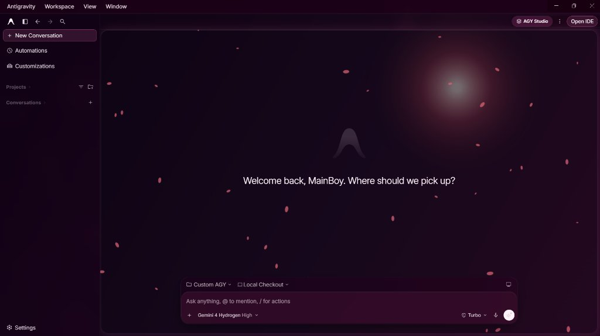
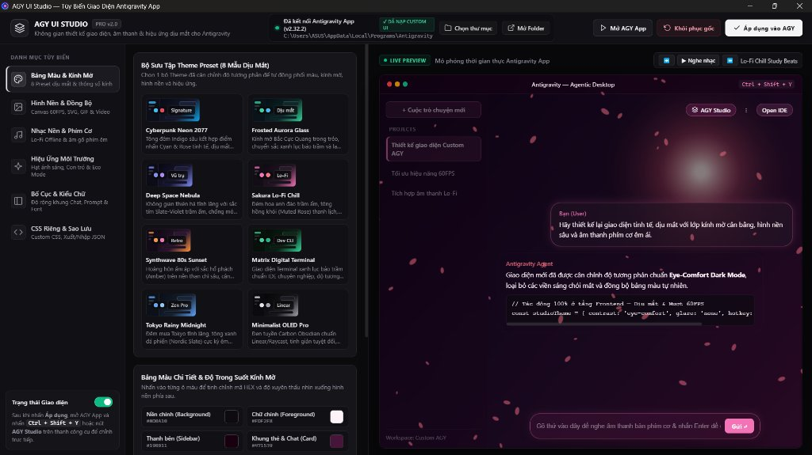
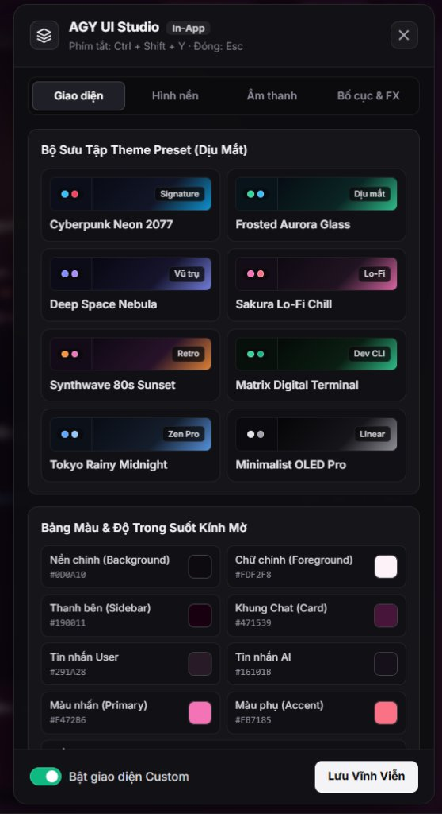

<div align="center">


# AGY UI STUDIO

### Biến Antigravity Desktop App Thành Không Gian Làm Việc Đậm Chất Riêng
**Giao diện Kính mờ (Glassmorphism) dịu mắt · Hình nền động 60FPS · Nhạc Lo-Fi Offline · Âm thanh phím cơ · Chỉnh trực tiếp ngay trong App**

[-0ea5e9?style=for-the-badge&logo=windows&logoColor=white)](https://github.com/MenBoyBMN/Custom-UI-AGY-APP/releases/latest)
[](https://github.com/MenBoyBMN/Custom-UI-AGY-APP/releases/download/v1.0.0/AGY-UI-Studio-v1.0.0-win32-x64.zip)
[](LICENSE)

<br />



*Antigravity Desktop App sau khi áp dụng Preset **Sakura Lo-Fi Chill** với nền tối dịu mắt, hiệu ứng cánh hoa rơi và nút **AGY Studio** tích hợp sẵn.*

</div>

---

## Làm việc hàng giờ với AI — Đừng để giao diện đơn điệu làm bạn mất cảm hứng!

Mỗi ngày bạn dành hàng giờ đồng hồ làm việc, viết code và trao đổi ý tưởng trên **Antigravity Desktop App**. Một giao diện tối giản quá mức, màu sắc đơn điệu đôi khi khiến mắt nhanh mỏi và dễ mất tập trung.

**AGY UI Studio** ra đời để giải quyết trọn vẹn điều đó: giúp bạn **"lột xác" toàn bộ giao diện Antigravity Desktop App** chỉ bằng vài cú click — **không cần biết lập trình, không ảnh hưởng dữ liệu, an toàn tuyệt đối và khôi phục về nguyên bản chỉ trong 1 giây**.

---

## Trải nghiệm thực tế bên trong AGY UI Studio

### 1. Thiết kế trực quan với Live Preview thời gian thực
Mọi thay đổi về màu sắc, độ mờ kính, hình nền động, hạt ánh sáng hay bố cục khung chat đều **hiển thị tức thì trên khung Live Preview**. Bạn còn có thể **nghe thử nhạc nền** và **gõ thử tiếng phím cơ** ngay trước khi áp dụng vào Antigravity App.

<div align="center">
  
</div>

### 2. Chỉnh giao diện ngay bên trong Antigravity App (`Ctrl + Shift + Y`)
Không cần mở lại phần mềm ngoài mỗi lần muốn đổi tâm trạng! Sau khi áp dụng một lần, nút **AGY Studio** sẽ xuất hiện gọn gàng trên thanh công cụ Antigravity App (hoặc bấm phím tắt **`Ctrl + Shift + Y`**) để bạn đổi theme, bật nhạc Lo-Fi hay tinh chỉnh bố cục **ngay lập tức trong khi đang làm việc**.

<div align="center">
  
</div>

---

## Vì sao hàng nghìn giờ làm việc của bạn cần AGY UI Studio?

### Bộ sưu tập 8 Theme "Eye-Comfort" — Làm việc đêm không mỏi mắt
Các bảng màu được cân chỉnh độ tương phản chuẩn **Eye-Comfort Dark Mode**, loại bỏ ánh sáng chói gắt nhưng vẫn sắc nét từng dòng code:

| Phong cách | Điểm nhấn nổi bật | Phù hợp cho |
| :--- | :--- | :--- |
| **Cyberpunk Neon 2077** | Nền Indigo sâu kết hợp điểm nhấn Cyan & Rose tinh tế | Làm việc đêm, vibe tương lai |
| **Frosted Aurora Glass** | Kính mờ Bắc Cực Quang xanh lục bảo & lam biển | Thư giãn, tập trung cao độ |
| **Deep Space Nebula** | Không gian thiên hà tím Slate-Violet trầm ấm | Suy nghĩ sâu, viết tài liệu |
| **Sakura Lo-Fi Chill** | Đêm hoa anh đào hồng khói thanh lịch | Nghe nhạc Lo-Fi, sáng tạo |
| **Synthwave 80s Sunset** | Hoàng hôn hổ phách trên nền than chì sâu | Phong cách Retro nổi bật |
| **Matrix Digital Terminal** | Tông xanh Terminal chuẩn IDE chuyên nghiệp | Lập trình viên thuần túy |
| **Tokyo Rainy Midnight** | Đêm mưa Tokyo xanh đá phiến êm dịu | Đọc hiểu & nghiên cứu lâu |
| **Minimalist OLED Pro** | Đen tuyền Carbon Obsidian chuẩn Linear/Raycast | Tối giản tuyệt đối, không xao nhãng |

> Ngoài 8 Preset sẵn có, bạn có thể tinh chỉnh từng mã màu HEX (9 lớp màu độc lập), độ trong suốt kính mờ (**Glassmorphism Opacity**), độ nhòe (**Backdrop Blur**), độ bo góc và ánh sáng viền dịu (**Subtle Glow**).

---

### Hình nền động 60FPS, Video & Tự động phối màu
- **10 Hình nền tích hợp sẵn 100% Offline**: 6 hình nền Canvas 60FPS mượt mà (*Tinh Vân Vũ Trụ 3D, Thành Phố Mưa Đêm, Sóng Cực Quang, Trăng Đêm Hoa Anh Đào, Chân Trời Hoàng Hôn 80s, Mưa Ký Tự Ma Trận*) + 4 hình nền Vector SVG sắc nét.
- **Dùng ảnh, GIF hoặc Video của riêng bạn**: Hỗ trợ `.png`, `.jpg`, `.webp`, `.gif`, `.svg`, `.mp4`, `.webm`.
- **Tự động cân bằng độ đọc chữ**: Tích hợp thanh làm tối nền (**Dimming**), làm mờ (**Blur**), độ bão hòa và tính năng **tự động đồng bộ bảng màu theo hình nền** để chữ luôn rõ ràng 100%.

---

### Nhạc nền Lo-Fi Offline & Âm thanh bàn phím cơ gây nghiện
- **4 bản nhạc nền WAV chất lượng cao** tích hợp sẵn (chạy hoàn toàn không cần Internet): *Lo-Fi Chill Study Beats, Cyberpunk Neon Arpeggio, Deep Space Cosmic Nebula, Rainy Tokyo Midnight Piano*.
- **Mini Music Player** gọn nhẹ ngay trong app, hỗ trợ nạp thêm playlist nhạc cá nhân (`.mp3`, `.wav`, `.ogg`, `.flac`, `.m4a`).
- **4 kiểu âm thanh gõ phím cơ êm tai**: *Holy Panda, MX Blue, Typewriter, Sci-Fi Bubble* kèm tiếng chuông nhẹ khi gửi tin nhắn — tạo cảm giác "flow state" cực đã kể cả khi dùng bàn phím laptop.

---

### Hiệu ứng môi trường mượt mà & Smart Eco Mode tiết kiệm pin
- **6 hiệu ứng hạt ánh sáng**: Đom đóm (*Fireflies*), Hoa anh đào (*Sakura*), Sao băng (*Starfield*), Tuyết rơi (*Snowfall*), Ma trận (*Matrix*), Chòm sao (*Constellation*).
- **Hiệu ứng con trỏ**: Vệt sáng Neon, Sóng gợn khi click, Đèn Spotlight dịu nhẹ.
- **Smart Eco Mode thông minh**: Tự động tạm dừng toàn bộ animation khi bạn thu nhỏ cửa sổ hoặc chuyển sang ứng dụng khác — **không gây tốn CPU/GPU hay hao pin laptop**.

---

### Tự do sắp xếp Bố cục & Chia sẻ cấu hình
- Điều chỉnh **độ rộng khung Chat & ô nhập Prompt** theo màn hình lớn/nhỏ (hỗ trợ cả nhập px tùy ý).
- Chuyển vị trí Sidebar (Trái, Phải hoặc Tự ẩn nổi), chọn kiểu thẻ tin nhắn (*Glass Cards, Chat Bubbles, Minimal*), bật **Zen Mode** tập trung tuyệt đối.
- Tùy chỉnh Font chữ giao diện, Font hiển thị code, kích thước chữ, thêm **Custom CSS** riêng và **Xuất / Nhập file `.json`** để lưu trữ hoặc chia sẻ giao diện đẹp cho bạn bè.

---

## Tải về & Sử dụng chỉ trong 30 giây

**Không cần cài đặt phức tạp. Không cần Node.js. Tải về là chạy ngay!**

1. Nhấn vào nút tải bản mới nhất bên dưới:
   > **[Tải AGY UI Studio v1.0.0 Portable (Windows x64 — .zip)](https://github.com/MenBoyBMN/Custom-UI-AGY-APP/releases/download/v1.0.0/AGY-UI-Studio-v1.0.0-win32-x64.zip)**
2. Giải nén file `.zip` vừa tải ra một thư mục bất kỳ trên máy.
3. Mở file **`AGY-UI-Studio.exe`**.
4. Studio sẽ **tự động tìm thấy Antigravity App** trên máy bạn → Chọn theme bạn thích → Nhấn **`Áp dụng vào AGY`** → Mở Antigravity App và tận hưởng thành quả!

*(Mẹo: Bên trong Antigravity App, nhấn **`Ctrl + Shift + Y`** bất cứ lúc nào để mở bảng chỉnh giao diện nhanh!)*

---

## Cam kết An Toàn & Khôi Phục Nguyên Bản 100%

- **Tự động sao lưu trước khi áp dụng**: Luôn tạo bản sao lưu gốc `app.asar.original.bak` kèm kiểm tra toàn vẹn dữ liệu **SHA256**.
- **Nhận diện đúng Antigravity Desktop App**: Tự động phân biệt và tránh tác động nhầm vào Antigravity IDE.
- **An toàn khi Antigravity tự cập nhật**: Tự động phát hiện phiên bản mới khi Antigravity App update, không bao giờ ghi đè bản mới bằng bản sao lưu cũ.
- **1 Click về mặc định**: Bất kỳ lúc nào bạn muốn quay lại giao diện gốc ban đầu, chỉ cần nhấn **`Khôi phục gốc`** trong AGY UI Studio — mọi thứ sẽ sạch sẽ nguyên vẹn như mới cài.

---

## Câu hỏi thường gặp (FAQ)

<details>
<summary><b>1. Dùng AGY UI Studio có làm mất lịch sử chat hay tài khoản Antigravity không?</b></summary>
<br />
<b>Không.</b> Công cụ chỉ tùy biến lớp hiển thị giao diện (Frontend) và âm thanh cục bộ, hoàn toàn không đụng chạm tới dữ liệu hội thoại, workspace hay thông tin đăng nhập của bạn.
</details>

<details>
<summary><b>2. Bật hình nền động và hiệu ứng hạt có bị giật lag hay tốn pin không?</b></summary>
<br />
<b>Không.</b> Toàn bộ hiệu ứng được tối ưu ở 60FPS và tích hợp sẵn chế độ <b>Smart Eco Mode</b> — tự động đóng băng animation ngay khi bạn thu nhỏ hoặc không focus vào cửa sổ Antigravity.
</details>

<details>
<summary><b>3. Nếu Antigravity App tự động cập nhật phiên bản mới thì sao?</b></summary>
<br />
Khi Antigravity App tự cập nhật, giao diện sẽ tạm trở về mặc định của phiên bản mới. Bạn chỉ cần mở lại <b>AGY UI Studio</b> và nhấn <b>Áp dụng vào AGY</b> một lần nữa — toàn bộ cấu hình và preset cũ của bạn vẫn được giữ nguyên.
</details>

<details>
<summary><b>4. Dành cho lập trình viên: Cách chạy từ mã nguồn & tự build .exe</b></summary>
<br />

Yêu cầu: **Windows x64** và **Node.js 18+**.

```bash
git clone https://github.com/MenBoyBMN/Custom-UI-AGY-APP.git
cd Custom-UI-AGY-APP
npm install

# Chạy ứng dụng từ mã nguồn
npm start

# Chạy kiểm thử đơn vị & E2E
npm test
npm run test:e2e

# Đóng gói bản Portable .exe
npm run pack-exe
```
</details>

---

<div align="center">

Nếu thấy **AGY UI Studio** giúp góc làm việc của bạn đẹp và chill hơn, hãy tặng dự án **1 Star** trên GitHub nhé!

Phát hành miễn phí theo giấy phép [MIT License](LICENSE) · Phát triển bởi [MenBoyBMN](https://github.com/MenBoyBMN)

</div>
